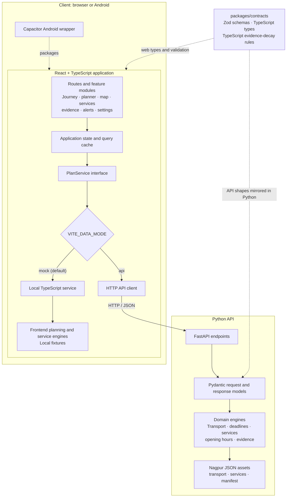

<div align="center">

# Noctra

### Night-time journey decisions, made with clarity.

**A full-stack decision-support application for night-shift workers in Nagpur, India.**

Compare journey options, understand deadline feasibility, and find essential services
with clear explanations of what is known, uncertain, or out of date.

[Product](#what-noctra-does) · [Architecture](#architecture) · [Get started](#get-started) · [API](#api-reference) · [Engineering](#engineering)

</div>

> **Safety note:** Noctra is a decision-support application, not an emergency-response service. For immediate danger or urgent assistance in India, call **112**.

## What Noctra does

Noctra helps people finishing late shifts make a more informed journey decision. It brings together journey timing, transport availability, deadline slack, route context, essential services, and evidence freshness in one interface.

| Capability             | What it provides                                                                                |
| ---------------------- | ----------------------------------------------------------------------------------------------- |
| Journey planning       | Candidate transport options, arrival-time ranges, deadline slack, feasibility, and explanations |
| Disruption response    | Replanning when journey conditions change                                                       |
| Essential services     | Nearby services ranked by location, need, opening status, and journey impact                    |
| Evidence transparency  | Provenance and freshness labels: **KNOWN**, **PROBABLE**, **OUTDATED**, and **UNKNOWN**         |
| Journey context        | Route map, stage timeline, fallback options, and safe-haven information                         |
| Connectivity awareness | Feed and service status to help explain limitations in available information                    |
| Android access         | Capacitor packaging for an Android application                                                  |

Noctra currently uses deterministic planning and service engines. It does not depend on a generative AI model. Its results are derived from the selected implementation, its rules, and its available data.

## Architecture



### System boundaries

- **Web application — `apps/web`:** React pages and feature modules collect journey inputs and present plans, routes, maps, service results, alerts, and evidence. The app uses TanStack Router for navigation and TanStack Query for server-style request state.
- **Service boundary — `PlanService`:** feature UI calls a shared interface for planning, replanning, service lookup, status, and alerts. This keeps screens independent of the selected data source.
- **Local mode — `VITE_DATA_MODE=mock`:** the local `PlanService` calls the frontend's deterministic planning and service engines directly. MSW is also configured to intercept supported `/api` requests during development; it is a separate request path.
- **API mode — `VITE_DATA_MODE=api`:** the HTTP client sends requests to the FastAPI service at `VITE_API_BASE_URL`.
- **Python API — `apps/api`:** FastAPI exposes planning, replanning, transport availability, services, and status endpoints. Pydantic models define the API's request and response shapes; Python engines evaluate transport, deadlines, services, opening hours, and evidence.
- **Contracts — `packages/contracts`:** Zod schemas and TypeScript types describe the web-facing data shapes, with TypeScript evidence-decay rules. The Python API has its own Pydantic models and corresponding Python decay implementation; the TypeScript package is not imported at runtime by Python.
- **Data — `data`:** the API engines read the checked-in Nagpur transport and service JSON assets and their provenance manifest.
- **Android — `apps/web/android`:** Capacitor packages the web application; the Android app uses the same client and data-mode configuration.

The local and API paths share the service interface, not an identical implementation. The local path runs TypeScript engines and uses local fixtures; the API path runs Python engines against the JSON assets. This distinction matters when interpreting results and evidence.

### Planning flow

```text
Journey form
  → PlanService.plan(request)
  → local TypeScript planner ──or── POST /api/plan
  → candidate journeys and deadline evaluation
  → route cards · map · stage timeline · evidence
  → selection, service lookup, or replan after a change
```

Service lookup follows a related flow: the client submits location, filters, and arrival context; the selected service engine searches and ranks results, evaluates opening status, and returns the available service evidence.

## Get started

### Prerequisites

- Node.js **20 or later**
- pnpm **9 or later**
- Python **3.11 or later** (only needed to run the API)

### Start the web application

From the repository root:

```powershell
pnpm install
pnpm dev
```

Open [http://localhost:5173](http://localhost:5173). By default, the web app selects the local TypeScript service and does not require the Python API.

### Start the Python API

In a second terminal, from the repository root:

```powershell
cd apps/api
python -m venv .venv
.\.venv\Scripts\Activate.ps1
python -m pip install -e .
python -m uvicorn app.main:app --reload --port 8000
```

Check that the API is running at [http://localhost:8000/health](http://localhost:8000/health). Interactive API documentation is available at [http://localhost:8000/docs](http://localhost:8000/docs).

To have the web client use the API, create `apps/web/.env`:

```dotenv
VITE_DATA_MODE=api
VITE_API_BASE_URL=http://localhost:8000
```

Restart the Vite development server after changing environment variables.

## Configuration

| Variable            | Default                 | Description                                                              |
| ------------------- | ----------------------- | ------------------------------------------------------------------------ |
| `VITE_DATA_MODE`    | `mock`                  | Selects the local TypeScript service (`mock`) or FastAPI client (`api`). |
| `VITE_API_BASE_URL` | `http://localhost:8000` | Base URL used by the API client.                                         |

Vite's development server also proxies `/api` requests to `http://localhost:8000`. The application selects hash-based routing when running inside the Capacitor Android WebView.

## Application routes

| Path         | Page                      |
| ------------ | ------------------------- |
| `/`          | Landing                   |
| `/dashboard` | Journey dashboard         |
| `/planner`   | Journey planner           |
| `/services`  | Essential services        |
| `/about`     | About and data provenance |
| `/tokens`    | Design tokens             |

## API reference

| Method | Endpoint                      | Purpose                                      |
| ------ | ----------------------------- | -------------------------------------------- |
| `GET`  | `/health`                     | Health and engine status                     |
| `POST` | `/api/plan`                   | Evaluate a journey plan                      |
| `POST` | `/api/replan`                 | Re-evaluate a journey after a disruption     |
| `GET`  | `/api/transport/availability` | Evaluate transport operating windows         |
| `GET`  | `/api/services`               | Find and rank nearby services                |
| `GET`  | `/api/services/response`      | Return service results and response metadata |
| `GET`  | `/api/status`                 | Return feed status and the data manifest     |

## Repository map

```text
apps/
  web/
    src/app/                 Bootstrap, router, environment, error boundary
    src/routes/              Landing, dashboard, planner, services, about, tokens
    src/features/            Journey, routes, map, services, evidence, alerts,
                              connectivity, settings, onboarding, social, emergency
    src/services/             PlanService interface and local/API implementations
    src/lib/                  Planning, transport, services, geo and UI helpers
    src/mocks/                MSW handlers and local fixtures
    tests/                    Unit and browser-level suites
    android/                  Capacitor Android project
  api/
    app/main.py               FastAPI application and endpoints
    app/planner/               API models and planning engines
    app/services/              Service search and opening-hours evaluation
    app/evidence/               Evidence freshness and decay
    tests/                      Python API and engine checks
packages/
  contracts/                   Zod schemas, TypeScript types, evidence decay
  config/                       Shared tooling configuration
data/
  MANIFEST.json                 Data sources, versions and provenance
  nagpur_transport_seed.json    Transport seed records
  nagpur_services_seed.json     Essential-service seed records
docs/
  ARCHITECTURE.md               Architecture notes
  DATA_PROVENANCE.md            Data and evidence policy
  DECISIONS.md                  Architecture decision records
  DESIGN_SYSTEM.md              Design-system reference
scripts/                        Repository helper scripts
```

## Engineering

### Evidence and data integrity

- Local Nagpur records are seed data, not live feeds. Review [`data/MANIFEST.json`](./data/MANIFEST.json) and the [data provenance policy](./docs/DATA_PROVENANCE.md) before interpreting them.
- Evidence is labeled **KNOWN**, **PROBABLE**, **OUTDATED**, or **UNKNOWN**. Fact-specific time-to-live rules lower confidence as observations age.
- Missing current information remains **UNKNOWN**; Noctra does not present absent ride feeds as verified availability.
- Risk is an **environmental risk proxy**, not a crime prediction or crime statistic.
- Opening hours, route estimates, and availability should not be treated as real-time verification unless a current authoritative source is explicitly identified.

### Quality commands

Run from the repository root:

| Command          | Purpose                                                        |
| ---------------- | -------------------------------------------------------------- |
| `pnpm typecheck` | Build/check shared contracts and type-check workspace packages |
| `pnpm lint`      | Run workspace ESLint checks                                    |
| `pnpm test`      | Run configured workspace unit suites                           |
| `pnpm test:e2e`  | Run the web browser-level suite                                |
| `pnpm build`     | Build contracts and the production web application             |
| `pnpm check`     | Run typecheck, lint, unit suites, and production build         |

The Python suite is located in `apps/api/tests`. Run it from `apps/api` in an environment where `pytest` is installed:

```powershell
python -m pytest
```

### Android build

Build and synchronize the web assets before opening the Android project:

```powershell
pnpm --filter @noctra/contracts build
pnpm --filter @noctra/web build
pnpm --filter @noctra/web cap:sync
```

Then open `apps/web/android` in Android Studio to run or package the application.

## Technology

| Area                      | Technologies                             |
| ------------------------- | ---------------------------------------- |
| Web client                | React 18, TypeScript, Vite, Tailwind CSS |
| Navigation and data state | TanStack Router, TanStack Query          |
| Maps                      | MapLibre GL JS, `react-map-gl`           |
| Mobile                    | Capacitor 7, Android                     |
| API                       | Python, FastAPI, Pydantic                |
| Contracts                 | Zod, TypeScript                          |
| Local API interception    | Mock Service Worker                      |
| Quality                   | ESLint, Vitest, Playwright               |

---

Built for CASCADE '26 at IIIT Nagpur. Map data © OpenStreetMap contributors.
