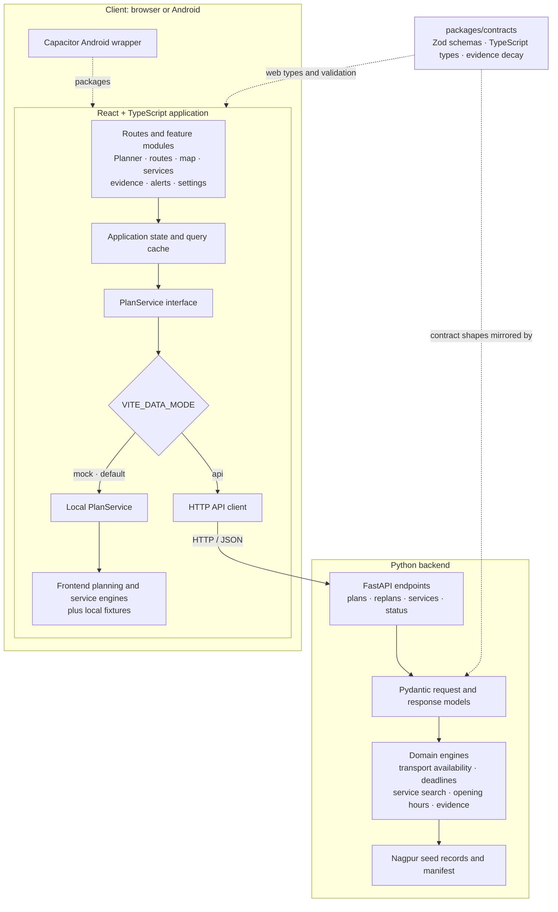

# Noctra

**A night-time journey decision engine for shift workers in Nagpur, India.**

Noctra helps people finishing a late shift compare ways home, understand whether they can meet a deadline, see what is known about their options, and find essential services along the way. It presents uncertainty explicitly: evidence is labeled **KNOWN**, **PROBABLE**, **OUTDATED**, or **UNKNOWN** rather than implying that unavailable information is live or verified.

> Noctra is a decision-support project, not an emergency-response service. For immediate danger or urgent assistance in India, call **112**.

## Contents

- [Capabilities](#capabilities)
- [Architecture](#architecture)
- [End-to-end flow](#end-to-end-flow)
- [Repository layout](#repository-layout)
- [Run locally](#run-locally)
- [Configuration](#configuration)
- [Routes and API](#routes-and-api)
- [Android application](#android-application)
- [Quality checks](#quality-checks)
- [Data and evidence policy](#data-and-evidence-policy)
- [Technology](#technology)

## Capabilities

- **Journey planning:** compare transport options with best, expected, and pessimistic arrival estimates, deadline slack, feasibility, and explanations.
- **Disruption replanning:** recalculate options when a reported disruption changes the journey.
- **Essential services:** find and rank nearby hospitals, pharmacies, police facilities, fuel, food, water, and other supported service types; evaluate opening status at the expected arrival time.
- **Evidence freshness:** show the provenance and freshness of facts, with deterministic decay from fresh evidence to OUTDATED or UNKNOWN.
- **Route context:** view route choices, journey stages, risk explanations, safe-haven information, and Plan B options.
- **Connectivity awareness:** present service and feed status so users can distinguish available information from degraded or unavailable information.
- **Mobile access:** package the web application for Android with Capacitor.

## Architecture



### Component responsibilities

- **Client application:** React routes and feature modules collect journey inputs and present plans, maps, service results, alerts, and evidence. Application state and the query cache support the UI.
- **Service boundary:** the `PlanService` interface keeps UI features independent of where planning and service data come from. `VITE_DATA_MODE=mock` selects the local TypeScript implementation; `VITE_DATA_MODE=api` selects the HTTP client.
- **Local implementation:** the local service calls the frontend planning and service engines and uses TypeScript fixtures. In development, Mock Service Worker handles supported `/api` requests; it is separate from the direct local `PlanService` path.
- **Python backend:** FastAPI exposes plan, replan, transport availability, services, and status endpoints. Pydantic models validate API shapes; Python domain engines evaluate transport, deadlines, service ranking, opening hours, and evidence using the Nagpur data assets.
- **Contracts and evidence:** `packages/contracts` provides Zod schemas, TypeScript types, and TypeScript evidence-decay rules. Python models mirror the API shapes, and the Python evidence module implements its own corresponding decay rules; the package is not a shared Python runtime dependency.
- **Android packaging:** Capacitor wraps the web application for Android. It uses the same React application and service selection as the browser build.

The local and API modes share the UI contract, but their implementations are distinct: the local path uses frontend engines and fixtures, while the API path uses Python engines and the checked-in JSON data assets. This separation allows either path to be selected without coupling page components to backend details.

## End-to-end flow

1. **Enter a journey.** The planner collects an origin, destination, shift end, deadline, and the transport modes to consider.
2. **Select a data source.** The application resolves the `PlanService` implementation from `VITE_DATA_MODE`.
3. **Evaluate options.** The selected planner evaluates transport availability and journey timing, then calculates ETA ranges, deadline slack, feasibility, evidence, and fallback options.
4. **Present the result.** The planner renders route cards, map context, stage timelines, verdicts, explanations, and evidence freshness.
5. **Inspect services.** A service request uses the selected location and filters; the service engine ranks nearby results and evaluates their opening status at the estimated arrival time.
6. **Respond to change.** A replan request evaluates updated journey conditions against the prior plan. The interface can surface the resulting route changes and alerts.
7. **Handle reduced connectivity.** Status and connectivity features communicate feed availability and degraded information. Facts without reliable current evidence remain explicitly uncertain.

```text
Journey form
    → PlanService.plan(request)
    → local planner OR POST /api/plan
    → plan response
    → route list + map + timeline + evidence
    → user selects a route or requests a replan

Service filters and arrival time
    → PlanService.getServices(request)
    → local service engine OR GET /api/services
    → ranked, time-aware service results
```

## Repository layout

```text
apps/
  web/
    src/app/              Application bootstrap, router, environment and error boundary
    src/routes/           Landing, dashboard, planner, services, about and tokens pages
    src/features/         Journey, routes, map, services, alerts, evidence, settings,
                          onboarding, connectivity, social and emergency features
    src/services/         PlanService interface and local/API implementations
    src/lib/              Frontend planning, transport, service, geo and evidence helpers
    src/mocks/            MSW handlers and explicitly labeled local fixtures
    tests/                Unit and browser end-to-end suites
    android/              Capacitor Android project
  api/
    app/main.py            FastAPI application and HTTP endpoints
    app/planner/           Request models, transport availability and deadline engines
    app/services/          Service search, ranking and opening-hours evaluation
    app/evidence/          Evidence freshness and decay
    tests/                 Python engine and endpoint suites
packages/
  contracts/               Shared TypeScript schemas, types and evidence-decay rules
  config/                   Shared project configuration
data/
  MANIFEST.json             Data coverage, versions and provenance
  nagpur_transport_seed.json
  nagpur_services_seed.json
docs/
  ARCHITECTURE.md           Additional architecture notes
  DATA_PROVENANCE.md        Evidence and source policy
  DECISIONS.md              Architecture decision records
  DESIGN_SYSTEM.md          UI design reference
scripts/                    Repository helper scripts
```

## Run locally

### Web application

Requirements: **Node.js 20 or later** and **pnpm 9 or later**.

```powershell
pnpm install
pnpm dev
```

Open `http://localhost:5173`. The default data mode is `mock`, so the web application can be explored without starting the API.

### Python API

Requirements: **Python 3.11 or later**.

From the repository root, create and activate a virtual environment, install the API package, and start the server:

```powershell
cd apps/api
python -m venv .venv
.\.venv\Scripts\Activate.ps1
python -m pip install -e .
python -m uvicorn app.main:app --reload --port 8000
```

The API health endpoint is available at `http://localhost:8000/health`. To use it from the web application, configure `VITE_DATA_MODE=api` and `VITE_API_BASE_URL=http://localhost:8000` in `apps/web/.env`.

## Configuration

Set these optional variables in `apps/web/.env`:

| Variable            | Default                 | Purpose                                                 |
| ------------------- | ----------------------- | ------------------------------------------------------- |
| `VITE_DATA_MODE`    | `mock`                  | Selects `mock` local behavior or the `api` HTTP client. |
| `VITE_API_BASE_URL` | `http://localhost:8000` | Base URL used by the API client.                        |

Vite's development server also proxies `/api` requests to `http://localhost:8000`.

## Routes and API

### Web routes

| Path         | Page                      |
| ------------ | ------------------------- |
| `/`          | Landing page              |
| `/dashboard` | Journey dashboard         |
| `/planner`   | Journey planner           |
| `/services`  | Essential services        |
| `/about`     | About and data provenance |
| `/tokens`    | Design tokens             |

The Android WebView uses hash-based routing so bundled pages resolve correctly without a web server.

### Python API endpoints

| Method | Path                          | Purpose                                       |
| ------ | ----------------------------- | --------------------------------------------- |
| `GET`  | `/health`                     | API health and engine status                  |
| `POST` | `/api/plan`                   | Create a transport and deadline-aware plan    |
| `POST` | `/api/replan`                 | Recalculate a plan after a disruption         |
| `GET`  | `/api/transport/availability` | Evaluate transport operating windows          |
| `GET`  | `/api/services`               | Find and rank services                        |
| `GET`  | `/api/services/response`      | Return service results with response metadata |
| `GET`  | `/api/status`                 | Return feed status and the data manifest      |

## Android application

The Android application is the Capacitor wrapper around the web build. Its app ID is `in.noctra.app`; its bundled web assets are produced in `apps/web/dist`.

To refresh the Android project after updating web assets:

```powershell
pnpm --filter @noctra/contracts build
pnpm --filter @noctra/web build
pnpm --filter @noctra/web cap:sync
```

Open `apps/web/android` in Android Studio to build or run the native application on an emulator or connected device.

## Quality checks

Run the repository's aggregate validation command from the root:

```powershell
pnpm check
```

It runs TypeScript checks, linting, unit suites, and the production build. The web package also provides `pnpm --filter @noctra/web test:e2e` for browser-level journey validation.

## Data and evidence policy

- Data records carry provenance and source classifications. The checked-in Nagpur transport and service records are local seed data, not live feeds.
- The manifest and [data provenance policy](./docs/DATA_PROVENANCE.md) describe sources and verification expectations.
- Evidence uses four states: **KNOWN**, **PROBABLE**, **OUTDATED**, and **UNKNOWN**. Freshness is calculated using fact-specific time-to-live rules in both the TypeScript contracts and Python API.
- A lack of current information is shown as **UNKNOWN**; the application does not infer live ride availability from absent feeds.
- Risk is presented as an **environmental risk proxy**, not a crime prediction or crime statistic.
- Availability, opening hours, and route estimates must not be interpreted as real-time verification unless a current, authoritative source is explicitly identified.

## Technology

- **Web:** React 18, TypeScript, Vite, Tailwind CSS, TanStack Router, TanStack Query
- **Mobile:** Capacitor 7 and Android
- **Maps:** MapLibre GL JS with `react-map-gl`
- **Contracts:** Zod schemas and TypeScript types in `@noctra/contracts`
- **API:** Python 3.11+, FastAPI, and Pydantic
- **Local request handling:** Mock Service Worker
- **Quality:** ESLint, Vitest, and Playwright

Built for CASCADE '26 at IIIT Nagpur. Map data © OpenStreetMap contributors.
