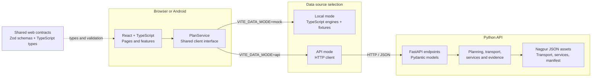

<div align="center">

# Noctra

### Clearer journey decisions after dark.

**A night-time journey decision-support app for shift workers in Nagpur, India.**

Plan around transport schedules and work deadlines, compare journey options, and find
essential services—with clear labels for what is known, uncertain, or out of date.

[What it does](#what-noctra-does) · [Architecture](#architecture) · [Get started](#get-started) · [API](#api-reference) · [Development](#development)

</div>

> **Safety:** Noctra is a decision-support tool, not an emergency-response service. If you are in immediate danger in India, call **112**.

<a id="what-noctra-does"></a>

## ✨ What Noctra does

Noctra brings journey timing, transport availability, deadline feasibility, route context, and nearby essential services together to help people make more informed decisions after a late shift.

| Capability            | What it provides                                                                                    |
| --------------------- | --------------------------------------------------------------------------------------------------- |
| Journey planning      | Candidate transport options, arrival-time ranges, deadline slack, feasibility, and explanations     |
| Disruption replanning | Updated options when journey conditions change                                                      |
| Essential services    | Nearby services ranked by location, need, opening status, and journey impact                        |
| Evidence transparency | **KNOWN**, **PROBABLE**, **OUTDATED**, and **UNKNOWN** labels with provenance and freshness context |
| Journey context       | Route map, stage timeline, fallback options, and safe-haven information                             |
| Android app           | Capacitor packaging for Android                                                                     |

The current planning and service engines are deterministic. Results depend on the selected implementation and available data; Noctra does not use a generative AI model.

<a id="architecture"></a>

## 🧭 Architecture



### How the pieces fit

- **Web app — `apps/web`:** React pages and feature modules provide journey planning, maps, services, evidence, alerts, and settings. TanStack Router handles navigation; TanStack Query manages request state.
- **Service boundary — `PlanService`:** The UI calls one interface for planning, replanning, service lookup, status, and alerts.
- **Local mode — `VITE_DATA_MODE=mock`:** The local service runs TypeScript planning and service engines with local fixtures. MSW can separately intercept supported `/api` requests during development.
- **API mode — `VITE_DATA_MODE=api`:** The API client sends requests to the FastAPI service at `VITE_API_BASE_URL`.
- **Python API — `apps/api`:** FastAPI endpoints use Pydantic models and Python engines for transport, deadlines, services, opening hours, and evidence.
- **Contracts — `packages/contracts`:** Zod schemas and TypeScript types define the web-facing data shapes. The API maintains corresponding Pydantic models and its own Python evidence-decay implementation; the TypeScript package is not imported at runtime by Python.
- **Data — `data`:** Checked-in Nagpur transport and service JSON assets are accompanied by a provenance manifest.
- **Android — `apps/web/android`:** Capacitor packages the web app and uses the same client configuration.

The local and API modes share the `PlanService` interface, not an identical implementation: local mode uses TypeScript engines and fixtures, while API mode uses Python engines and JSON assets.

### Planning flow

```text
Journey details → PlanService → local TypeScript planner or POST /api/plan
               → candidate journeys and deadline evaluation
               → route cards, map, timeline, and evidence
               → select an option, find a service, or replan after a change
```

Service lookup follows a similar flow: the selected service engine searches and ranks results, evaluates opening status for the expected arrival time, and returns available service evidence.

<a id="get-started"></a>

## 🚀 Get started

### Requirements

- Node.js **20 or later**
- pnpm **9 or later**
- Python **3.11 or later** (only required for the API)

### Run the web app

From the repository root:

```powershell
pnpm install
pnpm dev
```

Open [http://localhost:5173](http://localhost:5173). The default local mode runs without the Python API.

### Run the API

In a second terminal, from the repository root:

```powershell
cd apps/api
python -m venv .venv
.\.venv\Scripts\Activate.ps1
python -m pip install -e .
python -m uvicorn app.main:app --reload --port 8000
```

Check [http://localhost:8000/health](http://localhost:8000/health). Interactive API documentation is available at [http://localhost:8000/docs](http://localhost:8000/docs).

To use the API from the web app, create `apps/web/.env`:

```dotenv
VITE_DATA_MODE=api
VITE_API_BASE_URL=http://localhost:8000
```

Restart Vite after changing environment variables.

## Configuration

| Variable            | Default                 | Description                                                              |
| ------------------- | ----------------------- | ------------------------------------------------------------------------ |
| `VITE_DATA_MODE`    | `mock`                  | Use the local TypeScript service (`mock`) or the FastAPI client (`api`). |
| `VITE_API_BASE_URL` | `http://localhost:8000` | Base URL used by the API client.                                         |

Vite also proxies `/api` requests to `http://localhost:8000`. The app uses hash-based routing inside the Capacitor Android WebView.

## App routes

| Path         | Page                      |
| ------------ | ------------------------- |
| `/`          | Landing                   |
| `/dashboard` | Journey dashboard         |
| `/planner`   | Journey planner           |
| `/services`  | Essential services        |
| `/about`     | About and data provenance |
| `/tokens`    | Design tokens             |

## API reference

| Method | Endpoint                      | Purpose                                      |
| ------ | ----------------------------- | -------------------------------------------- |
| `GET`  | `/health`                     | Health and engine status                     |
| `POST` | `/api/plan`                   | Evaluate a journey plan                      |
| `POST` | `/api/replan`                 | Re-evaluate a journey after a disruption     |
| `GET`  | `/api/transport/availability` | Evaluate transport operating windows         |
| `GET`  | `/api/services`               | Find and rank nearby services                |
| `GET`  | `/api/services/response`      | Return service results and response metadata |
| `GET`  | `/api/status`                 | Return feed status and the data manifest     |

## Project structure

```text
apps/
  web/
    src/app/                 App bootstrap, router, environment, error boundary
    src/routes/              Landing, dashboard, planner, services, about, tokens
    src/features/            Journey, routes, map, services, evidence, alerts,
                              connectivity, settings, onboarding, social, emergency
    src/services/            PlanService interface and local/API implementations
    src/lib/                 Planning, transport, services, geo, and UI helpers
    src/mocks/               MSW handlers and local fixtures
    tests/                   Unit and browser-level suites
    android/                 Capacitor Android project
  api/
    app/main.py              FastAPI application and endpoints
    app/planner/              API models and planning engines
    app/services/             Service search and opening-hours evaluation
    app/evidence/              Evidence freshness and decay
    tests/                     Python API and engine tests
packages/
  contracts/                  Zod schemas, TypeScript types, evidence decay
  config/                      Shared tooling configuration
data/
  MANIFEST.json                Data sources, versions, and provenance
  nagpur_transport_seed.json   Transport seed records
  nagpur_services_seed.json    Essential-service seed records
docs/
  ARCHITECTURE.md              Architecture notes
  DATA_PROVENANCE.md           Data and evidence policy
  DEMO.md                      Demo guide
  DESIGN_SYSTEM.md             Design-system reference
scripts/                       Repository helper scripts
```

## 🛡️ Data, evidence, and safety

- Nagpur records in `data/` are seed data, not live feeds. Check [`data/MANIFEST.json`](./data/MANIFEST.json) and the [data provenance policy](./docs/DATA_PROVENANCE.md) before interpreting them.
- Evidence is labeled **KNOWN**, **PROBABLE**, **OUTDATED**, or **UNKNOWN**. Fact-specific freshness windows lower confidence as observations age.
- Missing current information remains **UNKNOWN**. Noctra does not present unavailable ride-hailing feeds as verified availability.
- Risk is an **environmental risk proxy**, not a crime prediction or crime statistic.
- Opening hours, route estimates, and transport availability are not real-time verification unless a current authoritative source is explicitly identified.

## Development

Run these commands from the repository root:

| Command          | Purpose                                                  |
| ---------------- | -------------------------------------------------------- |
| `pnpm typecheck` | Build shared contracts and type-check workspace packages |
| `pnpm lint`      | Run workspace ESLint checks                              |
| `pnpm test`      | Run configured workspace unit tests                      |
| `pnpm test:e2e`  | Run the web browser-level suite                          |
| `pnpm build`     | Build contracts and the production web app               |
| `pnpm check`     | Run typecheck, lint, unit tests, and production build    |

Run the Python API tests from `apps/api` in an environment with pytest installed:

```powershell
python -m pytest
```

### Build Android

Build and synchronize the web assets before opening the Android project:

```powershell
pnpm --filter @noctra/contracts build
pnpm --filter @noctra/web build
pnpm --filter @noctra/web cap:sync
```

Then open `apps/web/android` in Android Studio to run or package the app.

## Technology

| Area                         | Technologies                             |
| ---------------------------- | ---------------------------------------- |
| Web app                      | React 18, TypeScript, Vite, Tailwind CSS |
| Navigation and request state | TanStack Router, TanStack Query          |
| Maps                         | MapLibre GL JS, `react-map-gl`           |
| Mobile                       | Capacitor 7, Android                     |
| API                          | Python, FastAPI, Pydantic                |
| Contracts                    | Zod, TypeScript                          |
